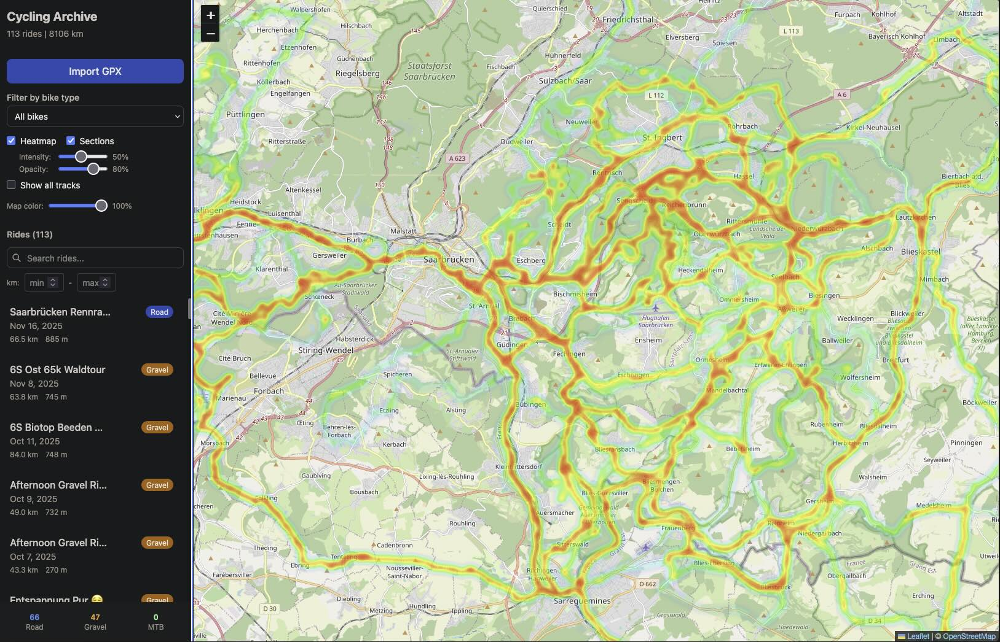
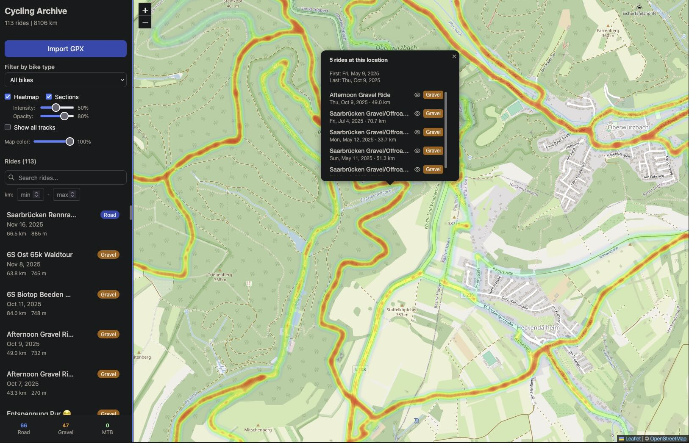

# Cycling Archive

A personal application for archiving cycling rides and rating road/trail sections to inform future route planning.

## Features

- Import rides from Garmin GPX files (single or bulk)
- Categorize rides by bike type (road, gravel, MTB)
- Interactive heatmap of all different ride types
- Rate sections of routes with 5-level rating system + add surface tags to be able to easily look up conditions of various sections
- Look up individual rides that went past a specific location on the map

## Screenshots

Simple Heatmap Example:


List rides that went past a specific location (onclick event on heatmap):



## Quick Start

Setup Node.js (tested with version v25.2.1 I suggest using nvm) as explained [here](https://nodejs.org/en/download/current).

```bash
# Install dependencies
npm run setup

# Start the application and open browser
./start.sh
```

Or manually:
```bash
npm run dev
# Then open http://localhost:5173
```

## Project Structure

```
cycling_map/
├── client/          # React frontend (Vite + Tailwind + Leaflet)
├── server/          # Express backend
│   └── src/
│       ├── index.js       # Server entry point
│       ├── db.js          # SQLite database setup
│       ├── gpxParser.js   # GPX file parsing
│       └── routes/        # API routes
├── data/            # SQLite database (created on first run)
├── sample_gpx/      # Sample GPX files
└── docs/            # Requirements documentation
```

## Usage

### Importing Rides

1. Click "Import GPX" in the sidebar
2. Drag & drop GPX files or click to browse
3. Select bike type (road/gravel/MTB)
4. Click Import

### Rating Sections

1. Select a ride from the sidebar
2. Click "+ Rate Section" button on the map
3. Click on the track to mark the START point
4. Click on the track to mark the END point
5. Select a rating and optional surface tags
6. Add notes if needed
7. Save

### Rating Levels

| Rating | Use for |
|--------|---------|
| Excellent | Perfect conditions |
| Good | Minor issues but rideable |
| Challenging | Difficult but manageable |
| Hard | Very difficult, consider avoiding |
| Unridable | Not possible/safe for bike type |

### Filtering

- Use the bike type dropdown to filter heatmap and rides
- Toggle heatmap and sections visibility with checkboxes

## Tech Stack

- **Frontend:** React, Vite, Tailwind CSS, Leaflet, React Query
- **Backend:** Node.js, Express
- **Database:** SQLite (via better-sqlite3)
- **Maps:** OpenStreetMap tiles

## Data Backup

The database is stored at `data/cycling_archive.db`. Simply copy this file to back up all your data.
