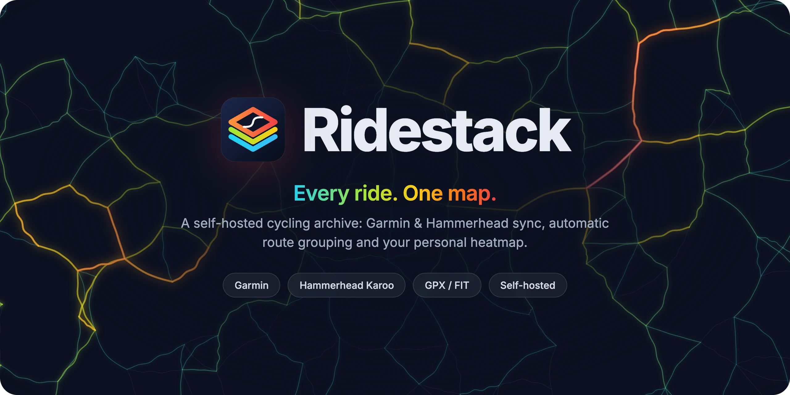
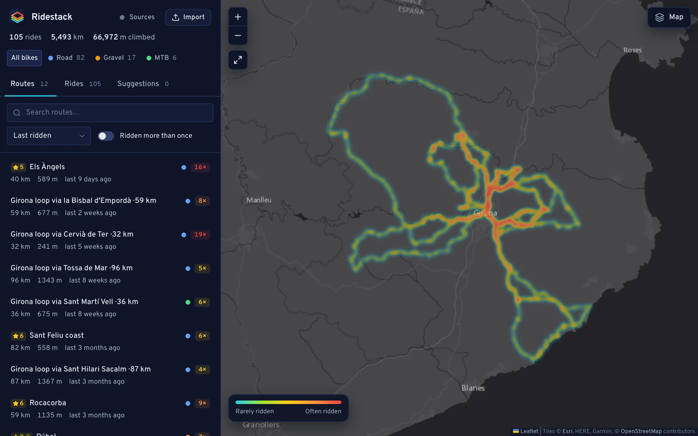
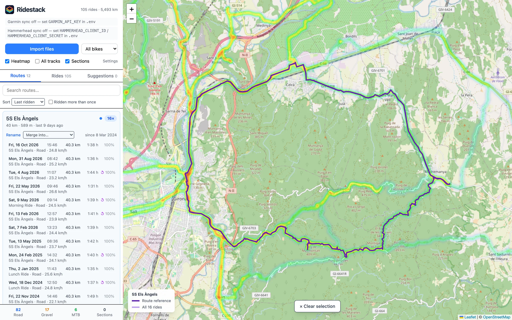
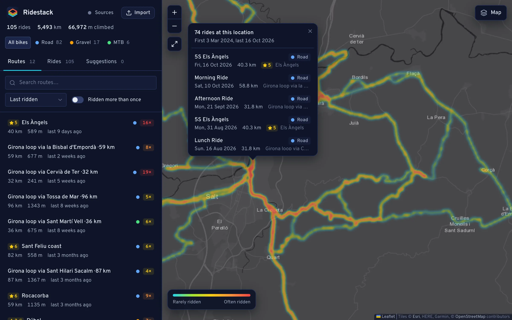
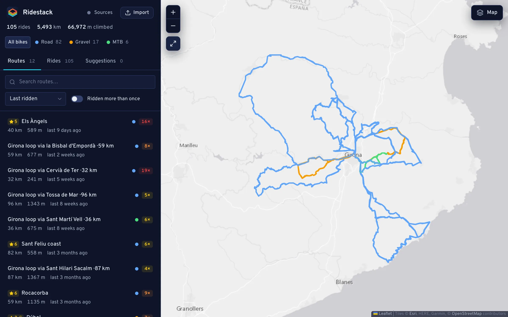
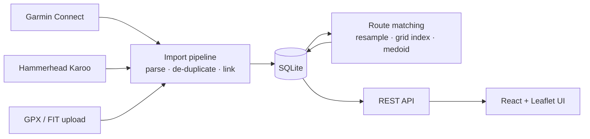

<p align="center">
  
</p>

<p align="center">
  <a href="https://github.com/schaefer-dev/ridestack/actions/workflows/ci.yml"></a>
  <a href="LICENSE"></a>
  
  
  
</p>

<p align="center">
  <a href="#features">Features</a> ·
  <a href="#screenshots">Screenshots</a> ·
  <a href="#quick-start">Quick start</a> ·
  <a href="#how-it-works">How it works</a> ·
  <a href="#contributing">Contributing</a>
</p>

---

**Ridestack** is a self-hosted archive for your bike rides. It pulls every ride from **Garmin
Connect** and **Hammerhead Karoo** (or takes GPX/FIT uploads), recognises when the same ride arrives
from several sources, groups rides you repeat into **routes**, and paints everything onto your
personal **heatmap**.

Your rides stay on your own machine, in a SQLite database next to the original files. It needs no
cloud account or subscription, and a Raspberry Pi is enough to run it.

## Features

**Sync & import**

- **Garmin Connect**: pulls your outdoor rides through the Garmin Personal API (hourly, plus a
  _Sync now_ button), including the full history on first start. It keeps the original FIT files
  and records which sensors were on the bike (power meter, speed sensor, …).
- **Hammerhead Karoo**: connect with OAuth in one click. Rides are polled hourly, plus _Sync now_.
- **Bike type from your sensors**: synced rides without a specific activity type (Garmin
  "cycling", Hammerhead "Ride") are tagged road, gravel or MTB by the power meter or speed sensor
  that was paired (optional, see [Bike sensors](#bike-sensors)).
- **GPX / FIT upload** for everything else.
- **One ride, many sources**: when the same recording arrives from Garmin, Hammerhead and an
  upload, it is recognised (same activity id, start within ±60 s, or ≥ 50 % time overlap) and
  linked to the existing ride instead of being imported twice.

**Routes**

- Rides that share **≥ 90 % of their path** are grouped into a route automatically, in either
  direction. Each route shows how often and when you rode it, plus your speed and time per ride.
- Rename, merge and move rides between routes. Manual changes are never overwritten.
- Automatic names from your ride titles or from OpenStreetMap place names
  (_"Girona loop via Banyoles · 53 km"_).
- **Planned-route suggestions**: names of your rated Hammerhead planned routes are suggested for
  matching route groups. Nothing changes until you accept.

**Map**

- **Heatmap** of everything you've ridden, filterable by bike type (road, gravel, MTB).
- **Map styles**: dark (default), muted light or the standard OpenStreetMap map. The muted styles
  make even roads you rode once stand out in the heatmap.
- **All tracks** view, and per-route view with the reference track and every ride on it.
- **Ride details**: distance, time, climb and speed, an elevation profile that marks the hovered
  point on the map, and the devices that recorded the ride.
- **"Who rode here?"**: click any spot to list every ride that passed it, with first and last
  date.
- **Section ratings**: mark road or trail sections (5 levels, surface tags such as gravel, mud or
  traffic) to plan future routes.

## Screenshots

<table>
  <tr>
    <td width="50%"></td>
    <td width="50%"></td>
  </tr>
  <tr>
    <td align="center"><sub><b>Heatmap</b>: all rides on the dark map, routes ranked by last ride</sub></td>
    <td align="center"><sub><b>Route detail</b>: 16 rides of one loop, one of them with its elevation profile</sub></td>
  </tr>
  <tr>
    <td width="50%"></td>
    <td width="50%"></td>
  </tr>
  <tr>
    <td align="center"><sub><b>Who rode here?</b>: 74 rides through one spot</sub></td>
    <td align="center"><sub><b>All tracks</b>: every ride, coloured by bike type, on the muted light map</sub></td>
  </tr>
</table>

<sub>Screenshots show the built-in demo dataset: synthetic rides on real roads around Girona, Spain.</sub>

## Quick start

Requires **Node.js ≥ 22.18** (see [`.nvmrc`](.nvmrc)). The server runs TypeScript directly, so
there is no build step.

```bash
git clone https://github.com/schaefer-dev/ridestack.git
cd ridestack
npm ci
```

**Try it with demo data** (no accounts needed):

```bash
npm run demo:seed                     # ~100 synthetic rides into data/demo.db
DB_PATH=./data/demo.db npm run dev    # → http://localhost:5173
```

**Use it with your own rides:**

```bash
cp .env.example .env    # add your Garmin and/or Hammerhead credentials (see below)
./start.sh              # or: npm run dev → http://localhost:5173 (API on :3001)
```

On first start the server creates the database in `data/`, and if a Garmin key is set it imports
your full Garmin history in the background (a few minutes). You can also just drop GPX/FIT files
into **Import files**.

### Connect your accounts

<details>
<summary><b>Garmin Connect</b></summary>

1. In Garmin Connect go to **Settings → Personal API** and create a token.
2. Put it into `.env` as `GARMIN_API_KEY=…` and restart.
3. Tokens expire (30 days to 1 year). When yours has expired, the sidebar shows an error; create a
   new one and replace it.

`npm run garmin:sync -- --dry-run` shows what a sync would import, link or skip before anything
is written.

</details>

<details>
<summary><b>Hammerhead Karoo</b></summary>

1. In the [Hammerhead dashboard](https://dashboard.hammerhead.io/settings#api_settings) (API
   settings) add the redirect URL `http://localhost:5173/api/hammerhead/callback`, or the address
   you open Ridestack at, e.g. `http://raspberrypi.local:5173/api/hammerhead/callback`. Set the
   same value as `HAMMERHEAD_REDIRECT_URI`.
2. Put `HAMMERHEAD_CLIENT_ID` and `HAMMERHEAD_CLIENT_SECRET` into `.env` and restart.
3. Click **Connect Hammerhead** in the sidebar and approve. The login is stored and refreshed
   automatically; if it is ever revoked, the sidebar shows **Reconnect**.

`npm run hammerhead:sync -- --dry-run` shows which Karoo rides would be linked to existing rides
and which would be imported.

</details>

### Running at home (e.g. on a Raspberry Pi)

Ridestack runs in development mode (`./start.sh` or `npm run dev`) and is light enough for a
Raspberry Pi. The web UI listens on `localhost` by default. To open it from other devices on your
network, start the two parts separately and expose the UI:

```bash
npm run server                       # API on :3001
npm run dev -w client -- --host      # UI on http://<your-pi>:5173
```

> [!WARNING]
> Ridestack has **no login**. Anyone who can reach it can see and change your rides. Keep it on
> your home network or behind a VPN/reverse proxy with authentication, and don't expose it
> directly to the internet.

## Configuration

All settings are environment variables in `.env`; [`.env.example`](.env.example) documents every
one. The most important:

| Variable                                                         | Default                      | Purpose                                                      |
| ---------------------------------------------------------------- | ---------------------------- | ------------------------------------------------------------ |
| `GARMIN_API_KEY`                                                 | –                            | Enables Garmin sync                                          |
| `HAMMERHEAD_CLIENT_ID` / `_SECRET` / `_REDIRECT_URI`             | –                            | Enables Hammerhead sync                                      |
| `GARMIN_SYNC_INTERVAL_MIN` / `HAMMERHEAD_SYNC_INTERVAL_MIN`      | `60`                         | Minutes between automatic syncs (`0` = only _Sync now_)      |
| `ROUTE_MATCH_THRESHOLD` / `ROUTE_MATCH_TOLERANCE_M`              | `0.9` / `40`                 | How similar two rides must be to share a route               |
| `GEOCODER_ENABLED` / `GEOCODER_LANGUAGE`                         | `true` / `de`                | Route names from OpenStreetMap place names, and their language |
| `DATA_DIR` / `DB_PATH`                                           | `./data` / `./data/cycling_archive.db` | Where the database, backups and original files live |
| `TZ_NAME`                                                        | system zone                  | Time zone for dates of uploaded GPX files                    |

### Bike sensors

Synced rides (Garmin, Hammerhead) can get their bike type from the sensors in the FIT file. Copy
[`bike-sensors.example.json`](bike-sensors.example.json) to `data/bike-sensors.json` and list
each bike's sensors: `deviceType` and `manufacturer` as the FIT SDK names them (`bikePower`,
`bikeSpeed`; `garmin`, `saxonar`, `stagesCycling`, …) and their ANT+ ids (shown in Garmin Connect
under the sensor, or in the `ride_devices` table). Garmin rides keep their activity type (road,
gravel, MTB) and use the sensors only when it is plain "cycling"; Hammerhead rides use a matching
sensor first, then the activity type. Anything left gets `default`. Restart the server, then run `npm run bikes:classify` to see what changes
for rides that are already imported, and `npm run bikes:classify -- --apply` to write it. Bike
types you picked yourself are never changed.

## How it works



- **One import pipeline.** Every ride, from any source, goes through the same transaction: ride,
  compact track, simplified geometry, grid cells, devices and route assignment. Before importing,
  Ridestack looks for an existing copy (same activity id, start within ±60 s, or ≥ 50 % time
  overlap of the shorter ride). A duplicate is _linked_ instead: the first copy wins, and later ones
  only fill in empty fields.
- **Route grouping.** Each ride is resampled to a point every 25 m. Two rides are the same route
  when at least 90 % of each lies within 40 m of the other (`min(coverage A→B, B→A) ≥ 0.9`). A
  long extension therefore makes a new route, while a short detour (a closed road) does not.
  Every route has a reference ride (its medoid); new rides are compared against the references of
  nearby routes (pre-filtered with a ~50 m grid index), so routes can't drift through chains of
  slightly different rides. Direction is detected separately, so reversed loops share a route.

## Privacy & your data

- Everything lives in `data/`: the SQLite database (WAL mode), automatic `backups/` before
  migrations, and the original FIT files in `fit/` so rides can be re-processed later.
- To back up while the server is running, use
  `sqlite3 data/cycling_archive.db ".backup backup.db"` (copying the file can miss recent writes).
- Ridestack only talks to the services you configure (Garmin, Hammerhead), the map tile servers
  (Esri for the dark and muted light styles, OpenStreetMap for the standard one), and Nominatim for
  route names (disable with `GEOCODER_ENABLED=false`). Nothing else is sent anywhere.

## Commands

| Command                                                  | What it does                                                         |
| -------------------------------------------------------- | -------------------------------------------------------------------- |
| `npm run dev` / `./start.sh`                             | API (watch mode) + web UI                                            |
| `npm run demo:seed`                                      | Fill `data/demo.db` with the synthetic demo dataset                  |
| `npm run garmin:sync -- --dry-run`                       | Show what a Garmin sync would import / link / skip                   |
| `npm run garmin:sync -- --backfill`                      | Walk the full Garmin history (retries gaps)                          |
| `npm run hammerhead:sync -- --dry-run`                   | Show what a Hammerhead sync would import / link / skip               |
| `npm run hammerhead:sync -- --backfill`                  | Walk the full Hammerhead history                                     |
| `npm run hammerhead:routes`                              | List your Hammerhead planned routes (read-only)                      |
| `npm run routes:rebuild`                                 | Re-cluster all rides (keeps manual moves and your route names)       |
| `npm run routes:evaluate [-- --save]`                    | Print route groups without writing; diff against a saved snapshot    |
| `npm run bikes:classify [-- --apply]`                    | Re-derive bike types of synced rides from `data/bike-sensors.json`   |
| `npm run check`                                          | Lint + typecheck + all tests (CI runs the same)                      |

Stop the server before running commands that write (`garmin:sync`, `hammerhead:sync`,
`routes:rebuild`, `bikes:classify -- --apply`).

<details>
<summary><b>Project structure</b></summary>

```
server/src/
  main.ts, app.ts, bootstrap.ts, config.ts
  api/          HTTP handlers (zod-validated) + central error handling
  db/           connection, versioned migrations
  rides/        repository + the single import pipeline and duplicate detection
  matching/     route similarity, clustering, naming, geocoder, planned-route suggestions
  garmin/       Personal API client, sync, activity type mapping
  hammerhead/   OAuth client, token store, sync, activity type mapping
  sync/         run bookkeeping + scheduler shared by both providers
  parsers/      GPX and FIT parsing
  track/, geo/  compact track storage, resampling, simplification, grid cells
  demo/         synthetic demo dataset (rides around Girona)
  cli/          sync, rebuild, evaluate and demo commands
server/test/    unit, matcher scenario, API, migration and sync tests
client/src/     React 19 + TanStack Query + Leaflet + Tailwind
assets/brand/   logo, icon and hero sources
```

</details>

## Contributing

Issues and pull requests are welcome. See [CONTRIBUTING.md](CONTRIBUTING.md) for the setup,
ground rules and the contribution license terms.

## License

Ridestack is © 2025–2026 Daniel Schäfer and licensed under the
[GNU Affero General Public License v3.0](LICENSE). You may use, modify and share it. If you run a
modified version as a network service, you must make its source code available to its users.

**Acknowledgements:** [Leaflet](https://leafletjs.com) and
[Leaflet.heat](https://github.com/Leaflet/Leaflet.heat), map data ©
[OpenStreetMap](https://www.openstreetmap.org/copyright) contributors, base maps by
[Esri](https://www.esri.com), [Lucide](https://lucide.dev) icons, the
[Overpass](https://overpassfont.org) typeface, the
[Garmin FIT SDK](https://developer.garmin.com/fit/), and routing by
[OSRM](https://project-osrm.org) and elevation by [Open-Meteo](https://open-meteo.com) for the demo
dataset.

<sub>Garmin and Hammerhead are trademarks of their respective owners. Ridestack is an independent
project and is not affiliated with or endorsed by them.</sub>
